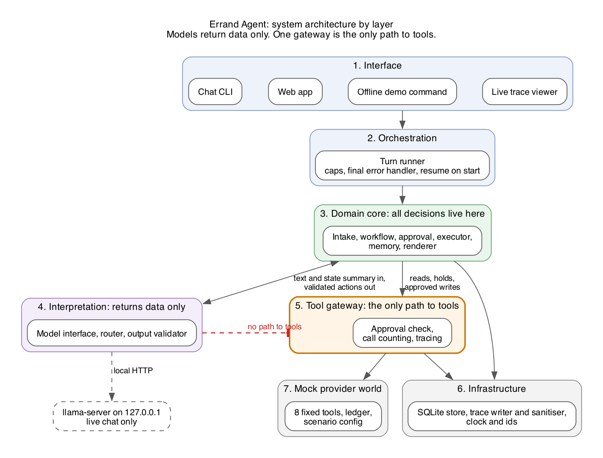
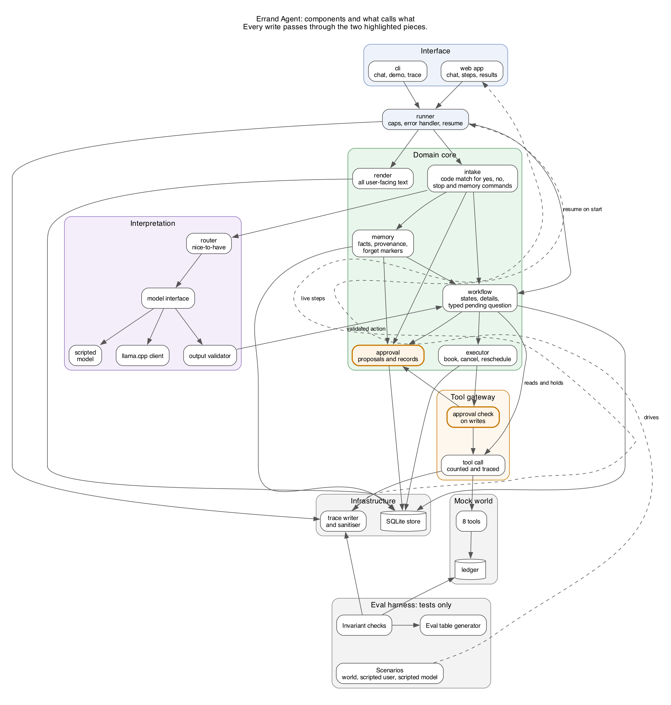
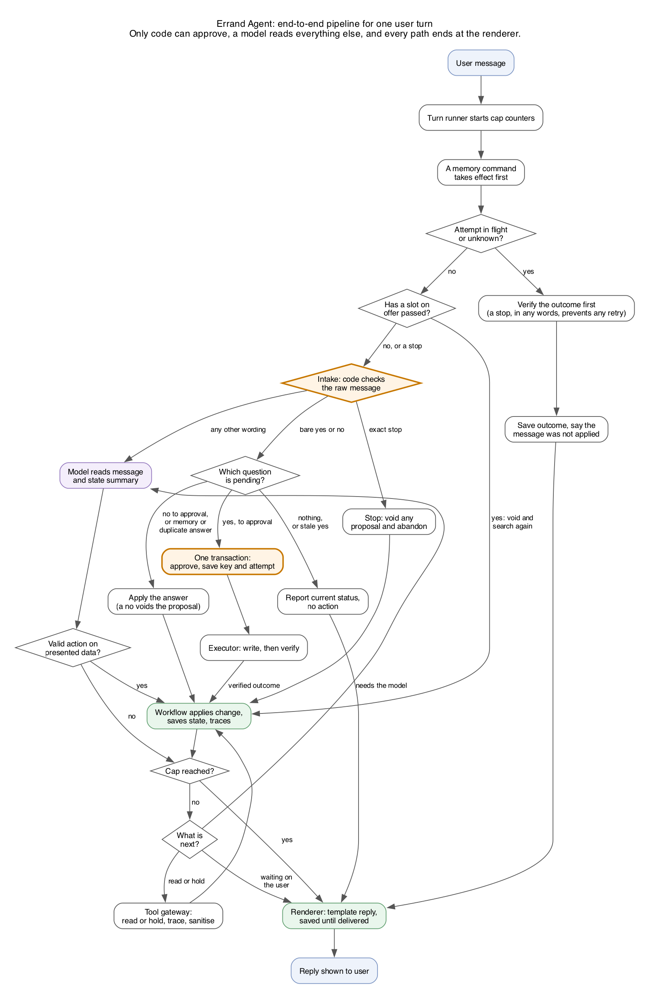
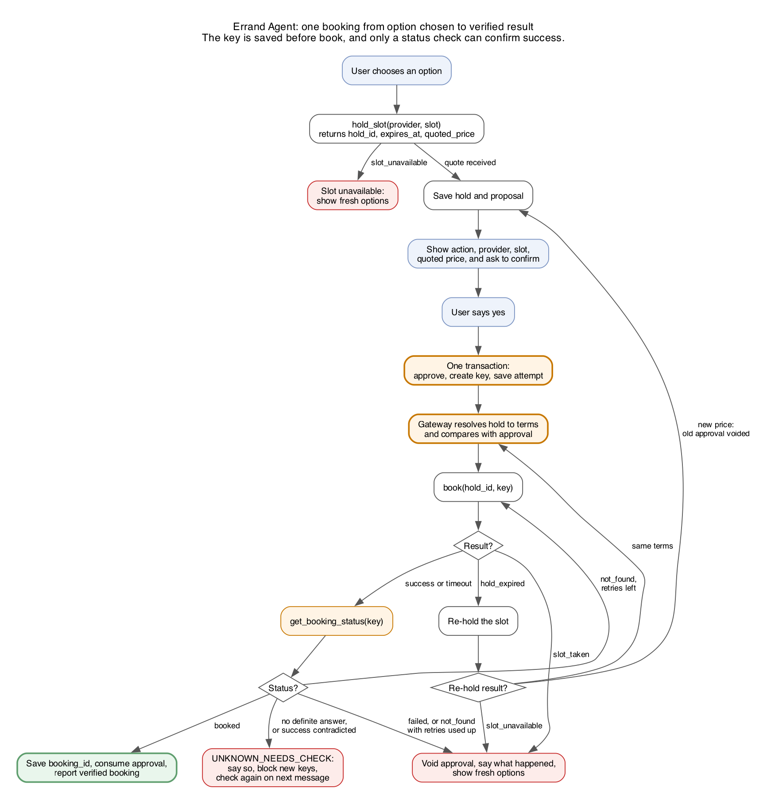

# Errand Agent: Architecture (HLD)

The system is a deterministic engine with a model on the side. Models return data only, and one tool
gateway is the sole path to any tool, so no model output can cause a write by itself.

## Layers



| Layer | Owns | Must never |
| --- | --- | --- |
| Interface | Reading input, printing replies, showing traces | Make decisions or call tools |
| Orchestration | One turn from message to reply; caps; final error handling | Contain business rules |
| Domain core | States, details, approvals, recovery, memory rules, reply text | Import a model client or a tool directly |
| Interpretation | Turning user text into validated structured actions | Call tools, write to the store, or produce user-facing text |
| Tool gateway | Running tools, blocking unapproved writes, sanitising results | Decide what to do next |
| Infrastructure | Saving state, writing traces, time and ids | Know about business rules |
| Mock world | Tool behaviour, failure injection, ground-truth ledger | Read the engine's storage |

**The rule that matters most:** the write tools are not reachable from the Interpretation layer at all.
The test harness also uses this boundary, by swapping in a scripted model that behaves badly on purpose.

## Components

The approval record and the gateway check, highlighted below, are the two pieces every write must pass.



| Component | Responsibility |
| --- | --- |
| `cli` | Chat, offline demo and trace viewing commands |
| `runner` | Runs one turn; enforces caps; holds the final error handler; resumes on start |
| `recovery` | Finishes in-flight attempts and shows undelivered replies |
| `intake` | Settles bare yes or no, stop and memory commands in code, before any model runs |
| `workflow` | Holds states, details and the one typed pending question; rejects illegal moves |
| `approval` | Creates proposals and approval records; approves atomically; voids on any change |
| `executor` | Runs the write and verify protocols for book, cancel and reschedule |
| `memory` | Stores facts with provenance; handles correct and forget, including effects on active runs |
| `render` | Writes every user-facing message from templates |
| Model interface | Returns structured actions from scripted or llama.cpp models |
| `router` | Picks which model handles a turn (nice-to-have) |
| Output validator | Rejects bad schemas and any provider, slot or option the engine did not present |
| Tool gateway | Only path to tools: checks approval on writes, counts calls, traces, sanitises |
| `store`, `trace` | SQLite state and JSON Lines trace files |
| Mock world | The 8 tools, the ledger and scenario configuration |
| Eval harness | Runs scenarios, checks invariants and generates the eval table |

## End-to-end pipeline

### One user turn



A turn follows these steps:

1. The turn runner starts the cap counters. If an attempt is in flight or unknown, it verifies that
   first, and the turn ends with the result. Only a stop changes what happens, by preventing a retry.
2. Intake checks the raw message in code. A bare yes or no answers the one pending question, whatever
   its kind, and stop and memory commands are handled here too.
3. If intake does not settle it, the model returns one structured output holding one or more actions,
   and `done: false` asks for another model step. The engine then runs its own reads and holds until the run
   is waiting on the user or a cap is hit.
4. The validator rejects any action that fails its schema, or that names a provider, slot or option the
   engine did not present. It checks a whole output first, so a rejected output changes nothing.
5. The workflow moves state, and every move is saved and traced.
6. The renderer writes the reply from templates and saves it until delivered. Every exit path ends here.

### One booking, from choice to verified result

The executor runs this sequence, and the gateway only checks and runs each single call. The hold comes
before approval, the key is saved before `book`, and only a status check can confirm success.



## Interpretation interface

The domain core depends on one interface, with three implementations. The scripted version drives evals
and demos; the llama.cpp version drives live chat; the router wraps llama.cpp versions behind the same interface.

| Action the model may return | What the engine does with it |
| --- | --- |
| Set intent | Starts the workflow type; a different type during an active run is refused |
| Update details | Validates and stores values, with source `user_this_run` |
| Select option | Accepted only if the option was presented and is still ahead; leads only to a proposal |
| Request a read tool | Runs it through the gateway; the model gets a safe summary back |
| Propose a memory change | Allowed only from the user's message, and shown back to the user |
| Need clarification | The engine picks the question from its template list |

Anything else is rejected and traced. No action type exists for book, cancel, reschedule, hold or
approve, so a hijacked model has nothing to ask for.

## Data model

| Table | Holds | Key rule |
| --- | --- | --- |
| `runs` | Run id, user, workflow type, state, details as JSON with sources, pending question, cap counters | One active run per user; state changes only through the transition table |
| `transitions` | Run, from, to, reason, time | Append only |
| `holds` | Hold id, provider, slot, quoted price, expiry | Lets the gateway resolve a `book` call to its terms |
| `approvals` | Action, provider, slot, price, booking id, hold id, shown-in reply id, source message id, status, idempotency key | One pending per run; moves from `pending` to `approved` in one transaction with its attempt |
| `attempts` | Approval id, key, status, retry count, result | Unique per approval; saved before the tool call |
| `booking_prices` | Booking id, price at booking | Source of price for later reschedule or cancel |
| `memory_facts` | User, key, value, provenance, status, evidence | Forgetting deletes the value and keeps the marker |
| `messages` | User, run, text | Gives every approval a source message |
| `replies` | Run, reply text, delivered flag | Saved before display, and shown on next start if undelivered |

The mock world keeps its own database. A restart therefore loses engine objects, while the provider's
records survive, exactly as with a real provider.

## Failure handling

| Failure | Detected by | Result |
| --- | --- | --- |
| `slot_unavailable` | Hold result | Fresh search |
| `slot_taken`, `slot_conflict` | Write result | Approval voided; fresh search |
| `hold_expired` | Write result | Re-hold; same terms continue, a changed price asks again |
| Timeout | Write result | Status check before any retry or report |
| Transient 503 | Cancel result | Retry with the same key, up to the cap |
| Process crash | In-flight attempt or undelivered reply found on start | Verify, continue, and show any undelivered reply; `SEARCHING` and `HOLDING` run again |
| Per-turn cap reached | Turn runner | Clear message; state kept; next message starts fresh counters |
| Per-run cap reached | Turn runner | Run moves to `FAILED` with a clear message |
| Any cap reached with a write in flight | Turn runner | Verification still runs, under its own cap; no new write starts |
| Status check gives no answer | Executor | `UNKNOWN_NEEDS_CHECK`; new keys blocked for that user; next message checks again |
| Invalid model output | Validator | Traced and counted against the cap; asks the user if it persists |
| Local model server down | Model client error | At start, the chat refuses and prints the command to start it. Mid-chat, a clear message; state kept; replies settled in code still work |
| Unknown error | Top-level handler | Traced; user told what is known; in-flight runs go to `UNKNOWN_NEEDS_CHECK` |

## Local-only enforcement

- The app refuses to start if a configured model host is not on this machine.
- Evals block every connection that leaves the machine, so a cloud call fails the test.
- Weights load from local files. Downloads happen once during setup and send no user data.
- Evals use no model server at all.

## Repo layout

```text
src/errand/
  cli.py              chat, demo and trace commands
  demos.py            offline scripted demos
  runner.py           turn runner, final error handler, resume on start
  gateway.py          tool gateway: approval check, tracing
  contract.py         tool failure types and known values
  core/
    domain.py         states, transition table, limits, records
    turn.py           one turn's budget, trace and reply
    intake.py         code matching for yes, no, stop and memory commands
    workflow.py       moves a run forward
    approval.py       approval records and state moves
    executor.py       book, cancel and reschedule protocols
    memory.py         memory rules
    when.py           date and time parsing
    render.py         reply templates
  interpret/
    model.py          interface, action schema, output parser
    scripted.py       scripted and looping models
    llama.py          live model client, prompt and output grammar
    router.py         picks no LLM, cheap or strong for a message
    route_examples.json  generated by the routing benchmark
  infra/
    store.py          SQLite
    trace.py          JSON Lines traces and sanitising
    clock.py          system and fake clocks
  mock/
    world.py          the 8 tools, ledger, scenario config
benchmarks/routing/   labelled turns, measured runs and results (live models, so not part of the tests)
tests/
  unit/               contract, intake, dates, model output, model client, chat command
  evals/              42 scenarios, edge cases, invariants, sabotage tests, table generator
docs/
traces/               written at run time, not committed
eval_results.md       generated by the test run
BUGS.md
```
